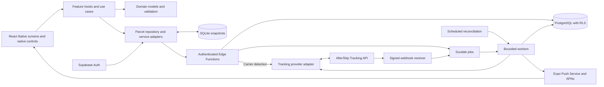

# Software Architecture Document

Status: proposed implementation baseline. Updated: November 13, 2026.

This document defines the planned architecture for the parcel-tracking iOS app in
the [screen concepts](README.md). The repository currently contains mockups only;
the dependencies, services, and validation described here have not been installed
or implemented.

## 1. Decisions and scope

| Area | Decision |
| --- | --- |
| Application framework | React Native with React and strict TypeScript. |
| Platform | Target iOS 27. Proposed minimum deployment target: iOS 27.0. Earlier iOS support would be a separate decision. |
| Development framework | Expo SDK 58 with development builds and Continuous Native Generation (CNG). |
| Design | Native iOS navigation and controls, Liquid Glass, and Apple's Human Interface Guidelines (HIG). |
| Initial product | Add parcels, view active and delivered shipments, inspect tracking activity, and receive delivery notifications. |
| Backend proposal | Supabase Auth, PostgreSQL, Edge Functions, Queues, and Cron. |
| Tracking proposal | An AfterShip Tracking API adapter behind our backend; confirm coverage and commercial terms before integration. |
| Device scope | iPhone first, with layouts that adapt to the available window size. Dedicated iPad, Android, and web products are outside the first release. |

React Native, iOS 27, and Liquid Glass are product requirements. Expo, the backend,
the tracking provider, and the other libraries below are architectural proposals.

### Mockup interpretation

| Reference | Required behavior | Architectural consequence |
| --- | --- | --- |
| [Deliveries](01-deliveries.png) | Search, Active/Delivered filter, arrival summary, parcel cards, plus action, Deliveries/History/Settings tabs. | One parcel repository feeds counts, filters, summaries, and history. Native tabs provide the application shell. |
| [Parcel details](02-parcel-details.png) | ETA, last update, milestones, reverse chronological activity, notification preference, carrier website. | A detail query loads normalized events and delivery estimates. Push detail above the tab navigator so the tab bar is absent. |
| [Add parcel](03-add-parcel.png) | Scan or enter a tracking number, detect/select a carrier, optional name, notification preference, submit/cancel. | Present a modal form, with a scanner and carrier picker inside its navigation stack. Validate both client and server input. |

The images establish information hierarchy and visual direction, not fixed pixel
dimensions. Their three parcels, dates, counts, ETA windows, and enabled switches
are illustrative data. The system owns the status bar, Dynamic Island, and home
indicator; the app must not draw them.

History and Settings have tab labels but no detailed mockups. Proposed behavior:
History provides the full delivered-parcel archive; the dashboard's Delivered
segment is a quick view of that same dataset. Settings provides appearance,
notification status, privacy information, and deletion of app data.

## 2. Platform and version baseline

Use Expo SDK **58.x** with its compatible **React Native 0.88.x** and React
versions. Keep the New Architecture and the supplied Hermes engine. Do not upgrade
React, React Native, Hermes, or native packages independently of the Expo support
matrix. SDK 58 supports iOS 27 and supplies the scene lifecycle and native
navigation needed for that platform. CocoaPods remains the supported default;
experimental Swift Package Manager integration is not part of this baseline.
([Expo SDK 58](https://expo.dev/changelog/sdk-58))

Build against the iOS 27 SDK using a pinned, supported Xcode 27.x release on an
Apple silicon Mac or an EAS macOS build image. Use the Swift compiler bundled with
that Xcode release for any local native module. Set the minimum deployment target
to `27.0` through `expo-build-properties`; the SDK used to compile and the minimum
OS allowed to install are separate settings.
([Xcode 27 release notes](https://developer.apple.com/documentation/xcode-release-notes/xcode-27-release-notes),
[Expo BuildProperties](https://docs.expo.dev/versions/latest/sdk/build-properties/))

Use Node.js **24.x**, at least 24.3, with npm and a committed `package-lock.json`.
Pin the exact Node, npm, Expo, and Xcode/build-image versions when scaffolding.
Resolve native packages with `npx expo install`; use `npm ci` in CI. Record exact
direct and transitive versions in the lockfile rather than inventing patch pins
in this design document. Check `npx expo install --check` and `npx expo-doctor`
before accepting an SDK upgrade. The SDK 58 release notes document its Node
requirements. ([Expo SDK 58](https://expo.dev/changelog/sdk-58))

Windows can host TypeScript development, Metro, and most unit tests. Local iOS
compilation, simulator testing, Instruments, and native debugging require macOS;
EAS Build provides remote builds for Windows developers. Use an installed
development build for native integration and device tests.

## 3. Technology and dependency inventory

These are the intended direct dependencies and tools. Install each with the
feature that needs it. Expo-managed dependencies follow SDK 58 compatibility;
other libraries must pass React 19 / React Native 0.88 compatibility checks before
their exact versions are committed. Transitive dependencies remain lockfile-owned.

### Mobile runtime

| Technology / package | Purpose and boundary |
| --- | --- |
| `expo`, `react`, `react-native`, TypeScript | App framework, native renderer, and typed feature code. Hermes and Metro come from this toolchain. |
| `expo-router` | File-based routes, native stack navigation, modal presentation, deep links, and stable `expo-router/native-tabs`. Router owns all navigation state. |
| `react-native-screens`, `react-native-safe-area-context` | Native screen integration and safe-area geometry; install the versions required by Router/Expo. |
| `@expo/ui` | SwiftUI-backed controls through `@expo/ui/swift-ui`, wrapped by our design system for pickers, menus, and buttons where appropriate. |
| `expo-glass-effect` | Native `GlassView` and `GlassContainer` for custom navigation/control surfaces and capability checks. |
| `expo-symbols` | SF Symbols for parcel, scan, history, settings, and action icons. |
| React Native `StyleSheet`, `PlatformColor`, `useColorScheme`, `AccessibilityInfo` | Semantic styling, system appearance, and accessibility integration without an additional styling framework. |
| `@tanstack/react-query` | Server data queries, request deduplication, loading/error state, invalidation, and mutation coordination. |
| `@react-native-community/netinfo` | Connectivity signals for query retries and offline messaging. Combine with React Native `AppState` for foreground refresh. |
| `react-hook-form`, `@hookform/resolvers`, `zod` | Form state and shared runtime schemas for form values, request bodies, and API responses. |
| `expo-sqlite` | Last successful parcel/event snapshots, local preferences, and saved add-parcel drafts. Use explicit SQL migrations and bound parameters. |
| `expo-secure-store` | Keychain-backed authentication storage via a tested session-storage adapter. No credentials in SQLite. |
| `@supabase/supabase-js`, `react-native-url-polyfill` | Anonymous session lifecycle and authenticated backend access; isolate both behind service adapters. |
| `expo-camera` | Barcode scanning through `CameraView`; no recording or image upload. |
| `expo-notifications`, `expo-device`, `expo-constants` | Notification permissions, push registration, notification responses, and EAS project/device configuration. |
| `expo-clipboard` | Explicit user-initiated paste/copy; prefer the system paste control where available. |
| `expo-haptics` | Restrained confirmation/error feedback that supplements visible feedback. |
| `expo-linking`, React Native `Linking` | Route handling, notification navigation, opening approved carrier HTTPS links, and opening system settings. |
| `expo-localization`, JavaScript `Intl` | Locale-aware dates, times, numbers, and timezone presentation. Keep UI strings in a central catalog from the start. |
| `expo-splash-screen`, `expo-status-bar` | Startup presentation and system status-bar appearance. |
| `@sentry/react-native` | JavaScript/native crash reporting and sampled performance diagnostics, with sensitive fields scrubbed. |

The native UI choices are supported by
[Expo UI](https://docs.expo.dev/versions/latest/sdk/ui/),
[native tabs](https://docs.expo.dev/router/advanced/native-tabs/), and
[GlassEffect](https://docs.expo.dev/versions/latest/sdk/glass-effect/).
Data integration follows the
[TanStack Query React Native guidance](https://tanstack.com/query/latest/docs/framework/react/react-native)
and [Supabase React Native guidance](https://supabase.com/docs/guides/auth/quickstarts/react-native).

Use React component state for temporary selection, search text, and presentation
state. Use Context only for session and application configuration. Query data
must not also be mirrored into Redux or Zustand. Built-in `fetch`, `AbortController`,
and `Intl` cover the initial networking and formatting needs.

### Backend and external services

| Technology / service | Purpose and boundary |
| --- | --- |
| Supabase PostgreSQL and SQL migrations | Authoritative parcels, tracking events, notification preferences, device registrations, and processing records. Enable Row Level Security (RLS). |
| Supabase Auth | Anonymous authenticated users for the initial no-login experience. Each parcel is owned by a verified user ID. |
| Supabase Edge Functions / Deno / TypeScript | Authenticated application API, carrier integration, signed webhook ingestion, and bounded worker invocations. Use native HTTP handlers and `fetch`. |
| `@supabase/supabase-js`, `zod` in server functions | Database/API access and contract validation. Pin Deno imports and commit `deno.lock`. |
| Supabase Queues (`pgmq`) and Cron (`pg_cron`) | Durable provider/push jobs and scheduled retry/reconciliation work. Cron invokes short-lived workers; no always-running process inside an Edge Function. |
| AfterShip Tracking REST API | Proposed multi-carrier provider. Use a versioned HTTP adapter with fixture tests; no provider SDK or key in the mobile app. |
| Expo Push Service and Apple Push Notification service (APNs) | Backend sends Expo push messages, which are forwarded to APNs. Worker checks tickets/receipts and retires invalid device tokens. |
| Supabase logs and metrics | Server failures, queue backlog, provider latency, webhook processing, and push receipt monitoring. |

These choices keep operational responsibilities within a small managed backend.
Supabase documents [Edge Functions](https://supabase.com/docs/guides/functions),
[Queues](https://supabase.com/docs/guides/queues), and
[Cron](https://supabase.com/docs/guides/cron).
The provider adapter will use AfterShip's
[tracking API](https://www.aftership.com/docs/tracking/quickstart/api-quick-start)
and [signed webhooks](https://www.aftership.com/docs/tracking/webhook/webhook-signature).
Push handling follows [Expo's server delivery guidance](https://docs.expo.dev/push-notifications/sending-notifications/).

### Development, quality, and delivery tools

| Tool / package | Intended use |
| --- | --- |
| `expo-dev-client`, `expo-build-properties`, Expo CLI | Development builds, deployment target, config plugins, and CNG. |
| EAS CLI, EAS Build, EAS Submit | Reproducible signed builds and delivery to TestFlight / App Store Connect. |
| Xcode, CocoaPods, Ruby Bundler | Native build/debugging; pin Ruby/gems with `Gemfile.lock` when local native tooling is introduced. |
| `eslint`, `eslint-config-expo`, `prettier`, TypeScript compiler | Static analysis, formatting, and strict type checks. |
| `jest`, `jest-expo`, `@types/jest`, `@testing-library/react-native` | Domain and component behavior tests, using versions compatible with the selected React release. |
| Maestro CLI | Automated iOS end-to-end flows on a simulator. Complement these with manual physical-device checks for scanning, push, and accessibility. |
| Supabase CLI, Docker, Deno test runner, pgTAP | Local backend, database migrations/RLS tests, and function/adapter tests. |
| React Native DevTools, Xcode Instruments, Accessibility Inspector | Rendering, memory, startup, scrolling, and accessibility validation. |
| GitHub Actions, GitHub CLI, Dependabot | PR checks, controlled release workflows, dependency updates, and reviewable delivery. |

Use the [Expo Jest setup](https://docs.expo.dev/develop/unit-testing/) and
[Sentry integration](https://docs.expo.dev/guides/using-sentry/) as starting points.
Reanimated, Worklets, Gesture Handler, an ORM, a second UI kit, and analytics SDKs
are not direct requirements for these screens. Retain any SDK-required peer
dependencies, but add custom animation or analytics packages only for a concrete
feature. EAS Update / `expo-updates`, widgets, Live Activities, App Intents,
Sign in with Apple, and cross-device account recovery are deferred features.

## 4. System structure and ownership



Screens render state and dispatch user intentions. Feature hooks own query keys
and use cases. Domain code defines validation, status mapping, and ETA semantics
without importing navigation, Expo, Supabase, or provider SDKs. Infrastructure
adapters implement persistence, networking, scanning, and notifications behind
small interfaces. Provider payloads do not become screen props.

PostgreSQL is the source of truth. TanStack Query owns the current in-memory
server-data view; SQLite stores only recoverable snapshots and local settings.
The repository validates network responses, updates snapshots, and returns domain
objects. Camera and push services expose events rather than navigating directly.
The app-level navigation coordinator resolves those events after session startup.

### Planned repository layout

```text
src/
  app/                    # Router layouts and thin route components
    (tabs)/               # Deliveries, History, Settings
    parcels/[id].tsx       # Root-stack detail route, above tabs
    add-parcel/            # Modal stack: form, scan, carrier picker
  features/
    deliveries/
    parcel-details/
    add-parcel/
    history/
    settings/
  domain/                 # Parcel/event models, status and ETA rules
  contracts/              # Runtime-neutral Zod request/response schemas
  data/                   # Repository, HTTP client, SQLite migrations
  services/               # Auth, notifications, camera, diagnostics
  ui/                     # Semantic tokens and native control wrappers
  localization/           # UI string catalog and formatting helpers
modules/                  # Local Swift Expo modules only if required
supabase/
  functions/              # API, provider adapter, webhook, workers
  migrations/             # Tables, indexes, RLS, jobs, database functions
tests/                    # Domain/integration fixtures
.maestro/                 # Critical user journeys
design/                   # Mockups and architecture decisions
```

Keep routes thin and dependency direction toward domain/contracts. Share contract
source between the app and functions without importing React or Node-only APIs
into the Deno runtime. SQL and platform-specific implementation stay in their
respective adapters. This is one app and one backend, with no monorepo framework
or microservice split required initially.

## 5. Navigation and iOS interaction

The root native stack contains the tab group, parcel details, and the Add Parcel
modal stack. Each tab retains its own scroll/navigation state. A detail push uses
the native back gesture and restores its originating list. A cold notification
launch establishes Deliveries as the back destination before opening the parcel.

Add Parcel supports Cancel, a keyboard-aware scrollable form, and a primary action
inside the safe area. The scanner and carrier picker remain within that modal
flow. Confirm dismissal only when it would discard a nonempty draft. Preserve the
draft after recoverable network errors; prevent duplicate submissions while a
request is pending.

Use opaque parcel IDs in routes and notification payloads. Never put tracking
numbers, credentials, or personal names in deep-link URLs. Resolve notification
routes only after authentication is ready, verify ownership through the API, and
show a helpful state for removed or inaccessible parcels.

## 6. Liquid Glass and iOS design requirements

Liquid Glass is a required part of the design. Prefer the actual system material
and controls: Router native bars first, SwiftUI-backed controls second, and
`expo-glass-effect` for custom functional surfaces. Do not approximate Liquid
Glass with a translucent rectangle, screenshot, or JavaScript blur effect.

| Surface | Treatment |
| --- | --- |
| Tab bar, navigation bar, toolbar/menu controls | Let native components adopt the system's Liquid Glass appearance and placement. |
| Plus action and floating action groups | Native glass control treatment where supported; clear labels and accessible hit regions. |
| Arrival summary, parcel cards, timeline, status labels | Semantic grouped backgrounds and readable content surfaces. Do not turn every card into glass. |
| Add Parcel inputs, picker, switches, primary action | Native input behavior and system control styles; use prominent styling for the primary action. |
| Scanner controls over camera preview | A small, legible native control layer with measured contrast. |

Default custom glass to the regular material and group adjacent custom glass
elements in `GlassContainer`. Avoid nesting glass over glass. Honor the user's
material, transparency, contrast, and motion preferences. These choices follow
[Apple's materials guidance](https://developer.apple.com/design/human-interface-guidelines/materials).

Wrap native UI behind components such as `AppButton`, `CarrierPicker`, and
`GlassActionGroup`. Check both `isGlassEffectAPIAvailable()` and
`isLiquidGlassAvailable()` before custom glass use; provide a semantic solid
surface when capability or accessibility settings require it. An iOS version
comparison alone is insufficient.
([Expo GlassEffect](https://docs.expo.dev/versions/latest/sdk/glass-effect/))

If a required behavior is not exposed by Expo, use a small local Swift Expo module
with SwiftUI/UIKit rather than replacing the React Native application. Custom
SwiftUI glass uses `GlassEffectContainer`, applies `glassEffect` after layout
modifiers, and enables interactive effects only for actionable elements. Guard
native APIs with availability checks and keep this bridge within `modules/`,
using Expo's `expo-modules-core` bridge infrastructure.
([Apple's custom glass guidance](https://developer.apple.com/documentation/swiftui/applying-liquid-glass-to-custom-views))

### Design acceptance criteria

- Use system typography, semantic colors, SF Symbols, and Dynamic Type. Text must
  wrap and layouts must reflow at accessibility sizes; switch the milestone row
  to a vertical presentation when needed.
- Support light and dark appearances, Bold Text, Increase Contrast, Reduce
  Transparency, and Reduce Motion. Test text and controls over changing content.
- Provide VoiceOver labels, roles, values, focus order, and error announcements.
  Communicate status with words and symbols as well as color; hide redundant
  decorative progress elements from accessibility.
- Give interactive elements at least a 44-by-44-point hit region. Preserve native
  gestures and accessible alternatives for swipe actions.
- Respect safe areas and keyboard insets on every edge. Use current window
  dimensions, flexible widths, and scrollable content, including when resized or
  rotated. Never derive layout from the mockup's image dimensions.
  ([Apple layout guidance](https://developer.apple.com/design/human-interface-guidelines/layout))
- Request camera and notification permissions in context. Make manual entry and
  in-app tracking usable when permissions are denied. Do not preselect a system
  permission merely because the mockup depicts an enabled switch.
  ([Apple privacy guidance](https://developer.apple.com/design/human-interface-guidelines/privacy))
- Use native menus, sheets, alerts, selection, paste behavior, and feedback.
  Haptics never replace a visible or spoken result. Destructive actions need clear
  wording and confirmation or an appropriate undo path.
- Localize all user-visible strings; format time and dates with locale and
  timezone information. Allow longer translations and right-to-left layout.

Apply the current HIG throughout implementation; a checklist does not establish
compliance by itself. Review with
[Apple's accessibility guidance](https://developer.apple.com/design/human-interface-guidelines/accessibility)
and test the resulting native UI on iOS 27. The app must also handle iOS 27's
scene lifecycle and resizable windows; preserve Expo's generated scene setup and
revalidate any native lifecycle customization.
([Expo's iOS 27 support](https://expo.dev/changelog/sdk-58))

## 7. Domain model and data behavior

| Entity | Required information |
| --- | --- |
| Parcel | Opaque ID, owner ID, carrier code, tracking number, optional display name, normalized status, notification preference, creation/update times, version, and last successful provider refresh. |
| DeliveryEstimate | Optional date or start/end window, precision, source, and timezone/offset when supplied. Absence means estimate pending. |
| TrackingEvent | Stable internal/provider event IDs, parcel ID, normalized status, description, optional location, occurrence time/precision, source timezone, and received time. |
| DeviceRegistration | Owner ID, installation ID, Expo push token, permission state, last seen time, and disabled time. |
| ProcessingRecord | Provider webhook ID, processing state, retry count, and deduplication keys for updates and notifications. |

Normalize statuses to `label_created`, `in_transit`, `out_for_delivery`,
`available_for_pickup`, `delivered`, `exception`, `returned`, or `unknown`.
Keep provider detail separately. The four mockup milestones are a presentation
of progress, not a complete state machine: failed attempts, returns, and
corrections must remain representable. A progress strip expresses milestones,
not a calculated percentage of distance or time remaining.

Convert timestamps with known offsets to UTC and retain source timezone/precision.
For date-only or timezone-unknown values, retain that uncertainty rather than
inventing midnight UTC. An exact delivery window appears only when supplied by
the provider. Sort activity by occurrence time with a stable tie-breaker; record
receipt time separately. An older webhook cannot overwrite a newer parcel
snapshot merely because it arrived later.

### Query, persistence, and offline policy

Query keys include the owner ID, parcel ID, filter, and pagination cursor where
applicable. List search uses name, carrier, and tracking number; apply filtering
on the backend for paginated history so unloaded rows are not silently excluded.
Counts and the arriving-today summary come from aggregate queries over the same
owned data, not the current page length.

Render persisted snapshots on launch with their actual freshness timestamp, then
revalidate when online. Connect Query's focus/online managers to AppState and
NetInfo. Refetch on foreground, user refresh, successful mutations, and received
push events; use bounded retry/backoff for transient failures. Do not promise
fixed-interval background execution on iOS.

Offline users can read cached parcels and events and save an add-parcel draft.
Creation, deletion, renaming, and notification changes require a successful online
mutation in the initial release. Show the pending/error state and preserve the
previous confirmed value on failure. There is no offline mutation queue or hidden
conflict-resolution mechanism in this baseline.

Persist only necessary snapshots, namespace them by owner, bound their size, and
version the SQLite schema. Clear Query memory, local snapshots, and credentials
when app data is deleted or the identity changes. Migrations must preserve local
drafts or explicitly explain recovery when a cache must be rebuilt.
([Expo SQLite](https://docs.expo.dev/versions/latest/sdk/sqlite/))

## 8. Backend contracts and update flow

Expose a versioned HTTPS JSON API through Edge Functions. The initial contract
includes carrier detection, parcel creation/list/detail/update/deletion,
paginated activity, device registration, summary counts, and deletion of all user
data. Runtime validation uses shared Zod schemas; return stable error codes with
safe user messages. The app never calls carrier APIs directly.

Each user request requires a verified Supabase session. Derive ownership from the
verified identity, never a client-supplied owner ID. Keep RLS on user tables even
when functions mediate access; privileged workers require explicit owner/provider
mapping checks. Expose no service-role credentials in client configuration.

1. **Add:** normalize the tracking number without dropping significant leading
   zeros, detect candidate carriers, let the user correct the choice, and submit
   an idempotency key. Persist the parcel and provider-registration job atomically.
   Show a pending registration state until the worker succeeds; an unresolved
   provider error must be visible and retryable.
2. **Register:** the worker registers tracking with the provider and stores the
   provider ID. Repeated requests reuse the existing registration. Enforce a
   per-owner active tracking-number/carrier uniqueness rule and handle provider
   duplicate responses. If registrations are shared internally, isolate owners'
   metadata and delete the provider registration only after its last owner leaves.
3. **Update:** verify the provider signature against the raw request body, validate
   the payload, persist its unique event ID and a durable job, then acknowledge.
   A worker normalizes events and applies version-aware updates. Duplicate and
   reordered webhooks must not generate duplicate activities or alerts.
4. **Notify:** commit the changed parcel and notification job in one transaction.
   Check the current parcel preference and device status before sending. Track
   push tickets/receipts, retry transient failures, and stop using invalid tokens.
   Reconcile queued/in-flight provider updates when a parcel is deleted.
5. **Reconcile:** scheduled, rate-limited work refreshes stale active shipments and
   retries failed jobs. Honor provider quotas and retry hints, bound worker batch
   sizes, and retain failed jobs for diagnosis. The mobile app refreshes the
   backend view rather than repeatedly querying the carrier.

Notifications are hints to refresh, not authoritative shipment records. Delivery
can be delayed or suppressed, and retries cannot guarantee exactly-once display.
Keep payloads minimal: a parcel ID and a generic update message by default.
Never embed a full tracking history or tracking number in a push payload.

## 9. Identity, privacy, and device permissions

Propose anonymous Supabase authentication because none of the mockups includes a
sign-in flow. This still creates an authenticated owner with RLS-protected data;
it is not an unauthenticated public database. Session loss can make that user's
data inaccessible without a linked identity. Account linking and recovery need a
separate product decision before promising cross-device continuity.
([Supabase anonymous sign-ins](https://supabase.com/docs/guides/auth/auth-anonymous))

Persist credentials through SecureStore and test refresh, expiry, reinstall,
deletion, and storage failure. Handle platform errors for large session payloads;
do not silently fall back to plaintext storage. Keychain persistence across
reinstall is not a recovery guarantee. Start/stop token refresh with application
lifecycle as required by the auth client.
([Expo SecureStore](https://docs.expo.dev/versions/latest/sdk/securestore/))

Camera permission is requested only after Scan Barcode. Decode locally, allow
the user to confirm the result, pause repeated scans, and release the camera when
the scanner loses focus. Configure a specific camera usage description; the
feature needs no microphone, photo library, or location permission. Keep manual
entry available for denied access and unsupported labels.
([Expo Camera](https://docs.expo.dev/versions/latest/sdk/camera/))

Store notification preference separately from OS permission. An enabled parcel
preference does not mean iOS has authorized alerts. Explain denied/disabled
permission and offer a Settings link; permit adding the parcel regardless.
Re-register changed device tokens and remove registrations during data deletion.

Use HTTPS, backend-managed secrets, request limits, per-user quotas, and anonymous
sign-up abuse controls before a public launch. Redact tracking numbers, names,
locations, tokens, and request bodies from diagnostics. Keep only the provider
fields required for tracking. Validate and allowlist carrier website destinations
before opening them. Describe the actual service data flows in the privacy policy,
App Store privacy disclosures, and required privacy manifests. Define retention,
deletion, backups, and provider-side cleanup before production release.

## 10. Build, testing, and release

CNG owns the generated native project. Keep reproducible native settings in
`app.config.ts`, config plugins, and local modules; do not rely on manual edits
that the next prebuild will overwrite. Use separate development, staging, and
production bundle IDs, backend projects, secrets, and push credentials. Public
client configuration contains only public identifiers/keys protected by backend
authorization. Production credentials remain in the build service or server.

PR checks will run a locked install, typecheck, lint, relevant unit/component
tests, backend contract/RLS tests, and Expo dependency checks. Run an iOS native
build for native/config/dependency changes and before release. Maintain a
TestFlight staging build; release through reviewed GitHub Actions/EAS workflows.
Initially ship fixes through new binaries. If OTA updates are adopted later,
define runtime compatibility, staged rollout, and rollback before enabling them.

| Validation area | Required scenarios |
| --- | --- |
| Domain / contracts | Status exceptions, ETA precision/timezones, tracking-number normalization, provider changes, duplicate/out-of-order events, and pagination/count consistency. |
| Components | Loading, empty, offline/stale, error/retry, ambiguous carrier, duplicate parcel, and mutation failure states. |
| Backend | RLS owner isolation, invalid signatures, idempotent creation, job retries, delete/update races, and notification preferences/receipt cleanup. |
| End-to-end | Manual add, scan on a real device, carrier correction, details/back navigation, History, notification deep link from a cold launch, and data deletion. |
| Native design | iOS 27 light/dark, largest text sizes, VoiceOver, contrast/transparency/motion settings, keyboard, resizing, safe areas, and native glass behavior. |
| Performance | Release-build startup, responsive input, long list scrolling, memory growth across navigation/scanning, and bounded network/provider requests. |

Use a virtualized React Native list for parcels and timeline rows. Start with
`FlatList`, stable keys, and incremental history loading. Native tabs currently
document limitations for FlatList scroll-to-top, scroll-edge detection, and
minimize-on-scroll. Keep tab minimization disabled initially and configure the
documented scroll-edge fallback, verifying contrast and insets on a device.
([Expo native tabs limitations](https://docs.expo.dev/router/advanced/native-tabs/))

Before the first implementation milestone is accepted, demonstrate a development
build on iOS 27 with native navigation, Liquid Glass, an accessible form, and the
scanner. Later milestones add persisted backend data and then provider updates
and push. This tests the highest-risk native integration before building the full
tracking workflow. No application build or runtime validation has occurred as
part of writing this document.

## 11. Decisions to resolve during implementation

| Decision | Proposed default / required evidence |
| --- | --- |
| Minimum OS | iOS 27.0. Confirm whether "target iOS 27" should also allow installation on older iOS versions. |
| Carrier service | AfterShip adapter. Validate UPS, FedEx, and USPS behavior with representative tracking data, webhook access, quotas, cost, and permitted consumer-app use. |
| Identity and recovery | Anonymous first-use sessions. Decide whether recoverable accounts / Sign in with Apple are needed for launch. |
| History and Settings | Use the behavior described above; create their detailed designs plus empty/error/dark/accessibility states. |
| Device layouts | iPhone first; test all supported iOS 27 window sizes. Decide whether to add a dedicated iPad experience. |
| Data operations | Set retention and deletion policy, backup/restore expectations, provider cleanup, service region, and anonymous-user abuse limits before production. |
| Performance and reliability | Measure release builds on the oldest supported target device, then record startup/scrolling budgets and backend freshness/recovery objectives. |

Review this document when an SDK, provider, supported OS range, or product scope
changes. Record consequential deviations as short architecture decision records
in `design/` and update the dependency inventory alongside the implementation.
